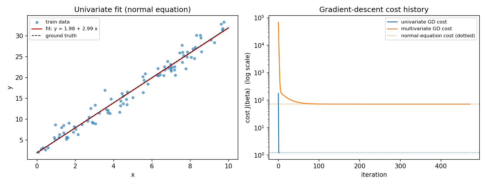

# Linear Regression Lab

Ordinary least squares **implemented from scratch** with numpy —
no `lstsq`, no scikit-learn — fitting the same problems two ways
and checking that they agree: **batch gradient descent** (iterative,
on standardised features, with a step size derived from the
problem's Lipschitz constant) and the **normal equation**
(closed form, with a pseudo-inverse fallback for singular designs).
Both solvers are run against datasets whose ground-truth
coefficients are known, so recovery is measured against the truth,
not merely against the other solver.

## Background

The model is `y ≈ X beta` with the CS229 cost convention
(full derivations and sources in [docs/RESEARCH.md](docs/RESEARCH.md)):

```text
J(beta) = (1 / 2m) * ||X beta - y||^2 ,     grad J = (1/m) X^T (X beta - y)
```

* **Normal equation.** Setting the gradient to zero gives
  `X^T X beta = X^T y` — one linear solve, no iteration, no step
  size. If `X^T X` is singular (a duplicated feature does it), the
  Moore–Penrose pseudo-inverse still returns a least-squares
  solution; `fit_normal_equation` reports which path it took.
* **Gradient descent.** For this quadratic cost the gradient is
  Lipschitz with constant `L = lambda_max(X^T X / m)`, so the fixed
  step `alpha = 1/L` is guaranteed to decrease the cost at every
  iteration — no tuning, no line search. *How fast* it converges
  is governed by the Hessian's condition number `kappa`, which is
  why the features are standardised first, and why the two datasets
  below behave so differently: their standardised condition numbers
  are **1.0** and **37.4**.

## Project structure

```text
linear-regression-lab/
├── regress.py                  # entry point
├── requirements.txt            # numpy, matplotlib
├── src/linear_regression/
│   ├── data.py                 # seeded synthetic datasets + split + CSV
│   ├── solvers.py              # normal equation, gradient descent
│   ├── metrics.py              # cost J, RMSE, R^2
│   └── cli.py                  # comparison experiment + plot
├── tests/
│   ├── test_solvers.py         # exact recovery, residual, agreement
│   └── test_metrics.py         # hand-computed values
├── examples/
│   ├── dataset.csv             # the multivariate dataset (synthetic)
│   ├── fit_and_cost.png        # fit line + cost curves, from a real run
│   └── example_output.txt      # captured run
└── docs/RESEARCH.md            # sources, derivations, documented choices
```

## How to run

```bash
python3 regress.py --outdir examples
python3 tests/test_solvers.py
python3 tests/test_metrics.py
```

## Example output

Committed run (`examples/example_output.txt`), abridged:

```text
=== univariate: y = 2 + 3x + noise (train 90 / test 30) ===
ground truth beta   : [+2.0000, +3.0000]
normal equation     : [+1.9804, +2.9932]  (path: solve)
gradient descent    : [+1.9804, +2.9932]  (2 iters, converged: True)
final train cost J  : NE 1.221784   GD 1.221784
test RMSE / R^2     : NE 1.3474 / 0.9707   GD 1.3474 / 0.9707
cross-checks        : ||X^T X beta_NE - X^T y|| = 2.313e-12;  max |beta_GD - beta_NE| = 4.996e-14

=== multivariate: price ~ size + rooms + age (synthetic) (train 180 / test 60) ===
ground truth beta   : [+50.0000, +2.5000, +8.0000, -1.2000]
normal equation     : [+49.9007, +2.4972, +7.9424, -1.1901]  (path: solve)
gradient descent    : [+49.9008, +2.4972, +7.9425, -1.1901]  (471 iters, converged: True)
final train cost J  : NE 72.292271   GD 72.292271
test RMSE / R^2     : NE 9.2746 / 0.9953   GD 9.2746 / 0.9953
cross-checks        : ||X^T X beta_NE - X^T y|| = 1.778e-09;  max |beta_GD - beta_NE| = 9.168e-05
GD diagnostics      : alpha = 1/L = 0.5134 (L = 1.948), standardised Hessian condition number 37.4
```

Reading the two blocks is the lesson of the lab:

* **Univariate: descent is exact in one step.** With one
  standardised feature (mean 0, variance 1) and an intercept, the
  Hessian *is* the identity (`kappa = 1`), so `alpha = 1/L = 1`
  jumps straight to the optimum; iteration 2 merely confirms the
  tolerance stop. Agreement with the closed form: 5e-14.
* **Multivariate: 471 iterations.** Here `rooms` is generated from
  `size` (bigger houses, more rooms — as in real data), and that
  correlation survives standardisation as `kappa = 37.4`. Descent
  still lands on the closed form (max coefficient difference
  9.2e-5, i.e. ~2e-6 relative) and on the same cost to six
  decimals — it just takes the long way round. Both solvers sit
  0.099 from the ground truth on the worst coefficient: that gap
  is the noise floor of the dataset (sigma = 12), not solver error,
  and the held-out R^2 of 0.995 says the same.
* Wall time in this run: ~0.05 ms (normal equation) vs ~10 ms
  (471 GD iterations). At this problem size both are noise-level
  numbers; the *iteration count* is the portable measurement, and
  the normal equation's O(n^3) solve is what stops being free as
  the feature count grows.



## Design decisions

- **Step size from the spectrum, not from tuning.**
  `alpha = 1/L` with `L = lambda_max` of the standardised Hessian
  makes the cost history *provably* monotone — and the test suite
  asserts monotonicity, so a step-size bug fails loudly. An
  optional exponential decay `alpha / (1 + decay * t)` is available
  but off by default: on a quadratic, decaying the step only slows
  the tail.
- **Costs always reported on the original scale.** GD fits on
  standardised features but maps coefficients back every iteration,
  so its cost curve and the normal equation's cost are the same
  quantity and can be plotted on one axis (see the figure: both
  curves land exactly on the dotted closed-form levels).
- **The singular case is a feature, not an exception.** The tests
  build a design with a duplicated column, assert `X^T X` really is
  rank-deficient, and check the pinv fallback still predicts the
  noiseless targets exactly and satisfies the normal equations.
- **Noiseless recovery is tested exactly.** With zero noise both
  solvers must return the planted coefficients to rounding error —
  a much sharper check than "close on noisy data".

## Limitations & future work

- Batch GD only; stochastic / mini-batch variants and momentum
  would show different cost curves on the same conditioning story.
- The normal-equation path solves `X^T X` directly; a QR- or
  SVD-based least-squares solve is numerically kinder when `kappa`
  is large (squaring the design squares the condition number) —
  the residual cross-check quantifies how much that matters here
  (relative residual ~1e-12: not much, at these sizes).
- No regularisation: ridge regression (one extra term in both
  solvers) is the natural next experiment, especially for the
  correlated multivariate design.
- Datasets are synthetic by design (the "house prices" are labels
  on generated numbers, stated wherever the data appears); swapping
  in a real CSV needs only a loader next to `data.py`.
